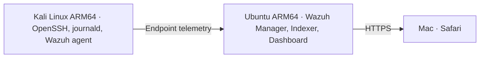

# Wazuh SIEM — SOC Monitoring & Threat Detection Lab

**Status:** Core lab complete (October 2026)  
**Environment:** Ubuntu Server 24.04.5 ARM64, Kali Linux ARM64, VMware Fusion  
**Stack:** Wazuh 4.14.8 · OpenSSH · Linux journald · File Integrity Monitoring

> All tests were intentionally generated in an authorized home lab. These detections are not evidence of a real attacker or a compromise.

## Project overview

Built a two-VM SOC monitoring environment. An Ubuntu Server VM hosted the centralized Wazuh manager, indexer, and dashboard. A Kali Linux endpoint sent security telemetry using an installed Wazuh agent (`kali-soc-agent`). Verified two detection scenarios: an intentionally failed SSH login and a real-time modification of a monitored test file.

## Architecture

Ubuntu VM: 4 virtual CPUs, approximately 8 GB RAM, 65 GB virtual disk with an approximately 61 GB root filesystem. VMs communicate on a private virtual network.

## Verified milestones

| Milestone | Evidence |
|---|---|
| Wazuh installed | Indexer, manager, Filebeat and dashboard initialized |
| Agent enrolled | Dashboard displayed one active agent |
| SSH failure detected | Wazuh rule **5760**, level **5**, after a controlled incorrect password |
| Linux log collection | Authentication failure confirmed in Kali's `journald` |
| FIM configured | Monitored `/home/kev/soc-fim-lab` using `realtime="yes"` |
| File modification detected | `test.txt` produced a real-time `modified` event and changed hashes |

## Investigation reports

- [LAB-SSH-001 — Controlled SSH Authentication Failure](incident-reports/ssh-authentication.md)
- [LAB-FIM-001 — Real-Time File Integrity Monitoring](incident-reports/file-integrity-monitoring.md)
- [Lab setup, configuration and troubleshooting notes](lab-configuration.md)

## Screenshot evidence

**Screenshots are being added separately after sanitization.** Evidence captured includes Wazuh installation, 0-to-1 agent connection, SSH terminal/journal and alert details, FIM agent configuration, test file baseline, FIM monitoring overview, and a matching real-time `test.txt` modification alert.

The screenshots are supplied in the companion evidence package. They will be placed in `screenshots/` under this project folder.

## Skills demonstrated

SIEM deployment · Linux endpoint monitoring · log analysis · SSH authentication event triage · MITRE ATT&CK mapping · Wazuh FIM · file hash verification · Linux VM administration · incident reporting.

## Key takeaways

A missing `/var/log/auth.log` does not mean authentication logs are absent; `journald` contained the SSH records. The SSH alert was correlated against the endpoint journal rather than assuming every alert was an attack. For FIM, the matching test-file path and before/after hashes confirmed actual content modification.

**Security:** No passwords, generated keys, or certificate files are included. Any previously disclosed Wazuh administrator credential should be rotated before the lab is reused.